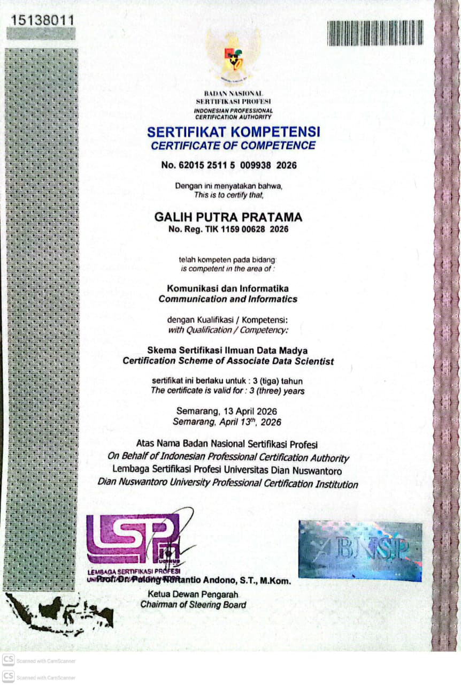

# Galih Putra Pratama, S.Kom.

**Production AI Engineer | RAG & Agentic Systems | Deep Learning & Computer Vision**

Informatics Engineering graduate (**GPA 3.74 / 4.00**, completed in 3.5 years at Universitas Dian Nuswantoro) and **BNSP-Certified Associate Data Scientist**. Experienced in architecting end-to-end production AI systems, including Hybrid RAG pipelines (`Qdrant` + `BM25` + Cross-Encoder Reranking), Multi-Agent Financial Copilots (`LangGraph` + `FastAPI`), and Computer Vision microservices (`EfficientNetV2` / `PyTorch` / `TensorFlow`).

---

## Flagship Production AI Systems (5-Pillar Engineering Standard)

Every flagship system is engineered and evaluated across five production pillars: **Technical Pipeline**, **Business Utility**, **Target Persona**, **Layman Proof of Success**, and **Quantitative Evaluation & Ablation Matrix**.

| System | Domain & Architecture | Key Production Benchmark | Links |
| :--- | :--- | :--- | :--- |
| **1. SmartInvest Unified AI Ecosystem** | **Multi-Agent + ML + Fullstack Fintech** `LangGraph` + `Google GenAI SDK` + `TensorFlow` + `Go Fiber` + `Next.js` | **MAE 0.0365 / RMSE 0.0422** `80%` faster portfolio risk screening across 423 assets | [Unified Docs](https://github.com/User-Galih/Porto-Galih/tree/main/Project/Project_12_SmartInvest_Ecosystem) \| [Live App](https://smartinvest-app-one.vercel.app) \| [Agent API](https://github.com/User-Galih/smartinvest-ai-agent) |
| **2. NusaPolicy Copilot** | **Hybrid RAG Regulatory Assistant** `Qdrant Dense` + `BM25 Sparse` + `BGE Reranker v2-m3` + `FastAPI SSE` | **0.94 Faithfulness / 0.89 Recall@5** `+17%` Recall@5 over dense-only RAG via Hybrid + Rerank | [Source Repo](https://github.com/User-Galih/nusapolicy-copilot) \| [Live Demo](https://nusapolicy-copilot.vercel.app) |
| **3. Waste Classifier Microservice** | **Computer Vision & Published Research** `EfficientNetV2B0` Two-Phase Transfer Learning + `Flask` + `Docker` | **94.8% Test Accuracy / 0.944 Macro-F1** Published in *JURIKTI* Vol. 2 No. 4 (`p. 518-527`) | [Source Repo](https://github.com/User-Galih/Klasifikasi_Sampah) \| [Journal DOI](https://doi.org/10.62951/jurikti.v2i4.682) |
| **4. G-Prompt AI Engineering Studio** | **Structured Prompt Compilation Workbench** `React 19` + `TypeScript` + `Gemini API Pro` + `Playwright E2E` | **100% Schema Pass Rate** `65%` fewer prompt iteration cycles across 7 domains | [Source Repo](https://github.com/User-Galih/g-prompt) \| [Live App](https://g-prompt-ten.vercel.app) |

> **SmartInvest Modular Repositories (Preserved Documentation):**
> In addition to the unified ecosystem overview, each engineering workstream maintains dedicated documentation:
> - **AI Engineering & Neural Recommenders:** [SmartInvest-App (`ai-engineer`)](https://github.com/User-Galih/SmartInvest-App)
> - **Multi-Agent LangGraph Orchestrator:** [smartinvest-ai-agent](https://github.com/User-Galih/smartinvest-ai-agent)
> - **Data Science & Statistical Clustering:** [SmartInvest-App (`data-science`)](https://github.com/User-Galih/SmartInvest-App)
> - **Fullstack Go Fiber + Next.js Platform:** [SmartInvest-App (`fullstack`)](https://github.com/User-Galih/SmartInvest-App)

---

## Core Technical Stack

- **LLM, RAG & Agentic AI:** Python, `google-genai` (Google AI Studio / Gemini API Pro), LangGraph, Qdrant Vector DB, BM25, `bge-reranker-v2-m3`, Prompt Engineering, RAGAS Evaluation
- **Deep Learning & Computer Vision:** TensorFlow, Keras, PyTorch, EfficientNetV2, OpenCV (SIFT/AKAZE), PennyLane (Hybrid Quantum-Classical QNN), Scikit-learn
- **Backend, API & MLOps:** FastAPI (Async SSE Streaming), Flask, Go (Fiber), PostgreSQL, Redis, Docker, GitHub Actions CI/CD, Pytest
- **Frontend & Interactive Telemetry:** TypeScript, React 19, Next.js (App Router), Tailwind CSS, Vite, Playwright

---

## Certifications & Publications

- **Peer-Reviewed Journal Publication (2025):** *Implementasi Arsitektur Deep Learning EfficientNetV2 dalam Sistem Klasifikasi Sampah Berbasis Web*, **JURIKTI** Vol. 2 No. 4, pp. 518-527. [DOI: 10.62951/jurikti.v2i4.682](https://doi.org/10.62951/jurikti.v2i4.682)
- **National Professional Certification (BNSP):** **Associate Data Scientist** (*Ilmuwan Data Madya*), Badan Nasional Sertifikasi Profesi (Valid until Oct 2028)
- **Coding Camp 2026 by DBS Foundation:** AI Engineer Cohort & Capstone Project Lead (SmartInvest)
- **Dicoding Indonesia:** *Membangun Proyek Deep Learning Tingkat Mahir*, *Belajar Fundamental Deep Learning*, *Cloud Practitioner Essentials (AWS)*

  

---

## Contact & Collaboration

- **Web Portfolio:** [https://porto-galih-eta.vercel.app/](https://porto-galih-eta.vercel.app/)
- **LinkedIn:** [linkedin.com/in/galih-putra-pratama-78a705285](https://www.linkedin.com/in/galih-putra-pratama-78a705285/)
- **Email:** [galihputrapratama29@gmail.com](mailto:galihputrapratama29@gmail.com)
